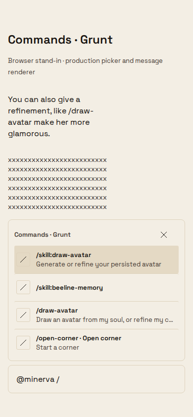
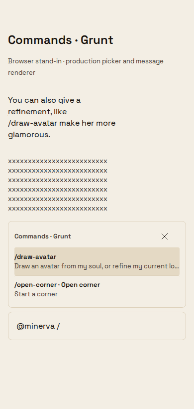
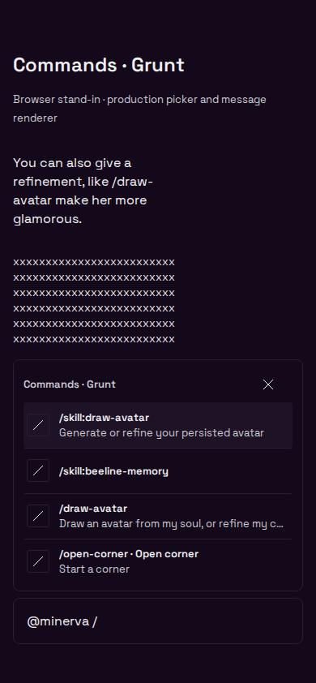
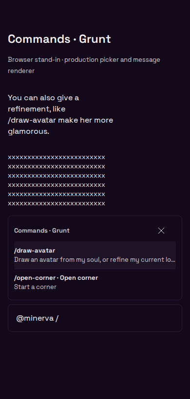
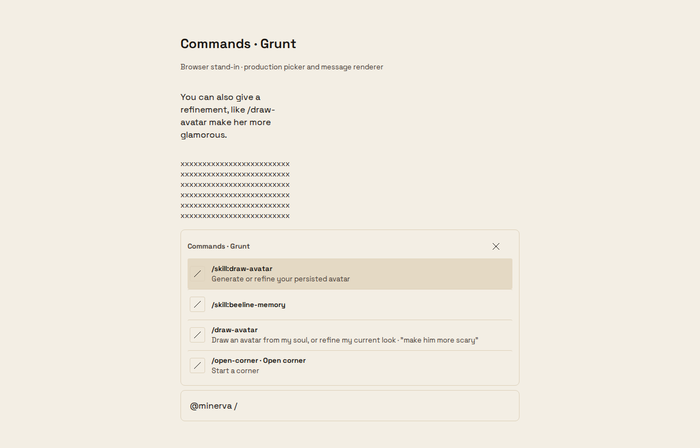
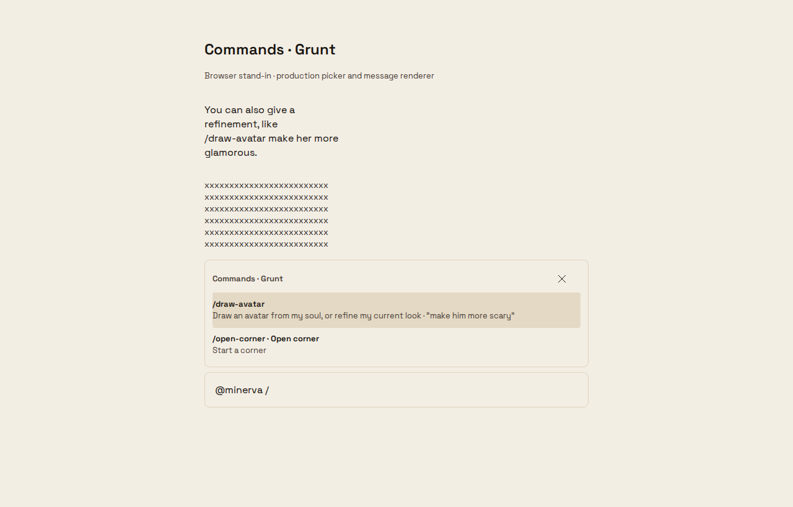
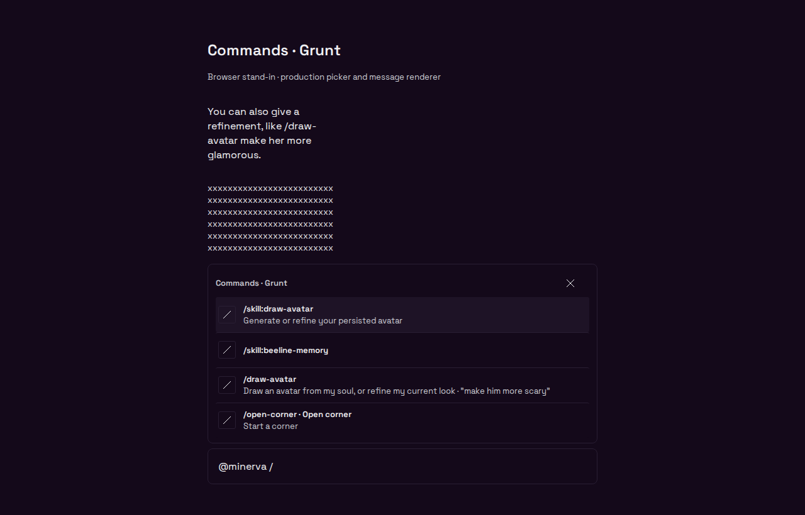
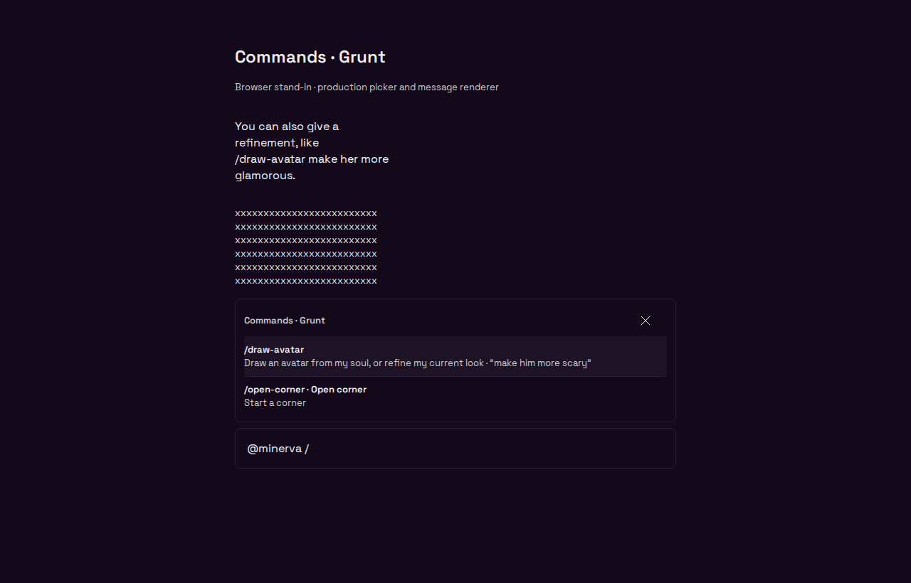

# Slash menu cleanup proof

Reproduction slash-dup and Reproduction slash-wrap. Run `node --import tsx scripts/prove-slash-menu.mjs` from the repository root. Its optional argument selects the baseline revision (default `ef2ad4125`).

These captures render the production SlashVerbPicker, SuggestionRow and MonoMarkdown with DOM adapters for native controls, production fonts and theme colors. They are browser stand-ins at phone (390px) and web (1280px) viewports, not installed native-device proof. The existing emulator was reachable but signed into the Latency Rig workspace, without Grunt or the original message. The supplied native screenshot establishes the break after the slash; Chromium's baseline breaks at the hyphen instead. The fixed command stays on one line in both. Long ordinary text still wraps. The catalog publisher receives `skill:draw-avatar` and `skill:beeline-memory`; only the Beeline avatar command remains, and clicking it selects `draw-avatar`.

| View | Before | After |
| --- | --- | --- |
| Bone phone |  |  |
| Obsidian phone |  |  |
| Bone web |  |  |
| Obsidian web |  |  |

Catalog refresh remains event driven: every harness `available_commands_update` republishes through the fixed publisher. The publisher is wired when a cold agent session starts in Rooms and corners; an already published row changes when the harness next advertises its snapshot, normally at the next session start, rather than through a migration or phone refresh.
